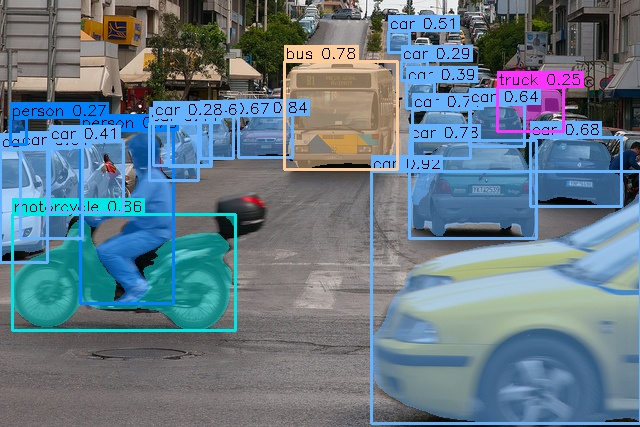
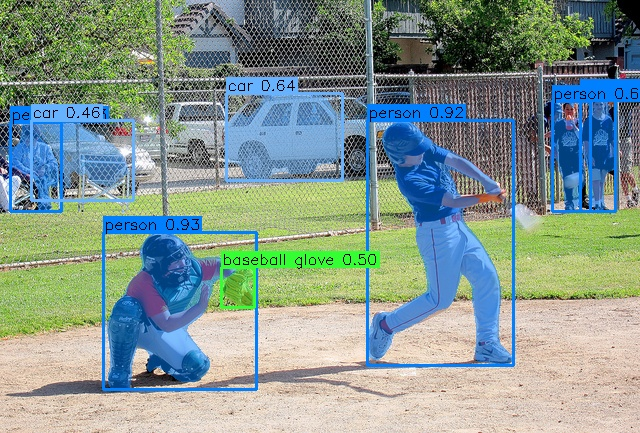

# Flash-YOLO

> ⚡ **A super-lightweight detection & segmentation framework — 31% fewer GFLOPs than YOLO26n
> for detection (18% for segmentation), millisecond GPU/CPU inference, and a complete independent
> pipeline: train · evaluate · export · infer. Raw dataset in, TensorRT engine out.**
>
> Core runtime is just PyTorch + NumPy — no monolithic abstractions, no ultralytics dependency.

<p align="center">
  <a href="CHANGELOG.md"></a>
  <a href="LICENSE"></a>
  <a href="https://www.python.org/downloads/"></a>
  <a href="https://pytorch.org/"></a>
</p>

<p align="center">
  
  
  <br>
  <em>Detections by the 100-epoch Flash-YOLO checkpoint — COCO val2017 samples, 640 input</em>
</p>

COCO val2017, official pycocotools (`scripts/eval.py`), 640 input. E2E = NMS-free default path;
NMS = one-to-many head + NMS. Official rows are Objects365 pretraining + COCO finetuning;
"from scratch" rows use the built-in baseline recipe for 100 epochs — not like for like.

| Model | Training | E2E mAP50-95 | E2E mAP50 | NMS mAP50-95 | NMS mAP50 | Params | GFLOPs |
|---|---|---:|---:|---:|---:|---:|---:|
| YOLO26n · official weights | O365 + COCO | **40.27** | 55.80 | **40.89** | 56.87 | 2.57M | 5.48 |
| YOLO26n · this repo | 100 ep from scratch | 36.22 | 51.32 | 37.15 | 52.67 | 2.57M | 5.48 |
| Flash-YOLO · this repo | 100 ep from scratch | 33.77 | 48.63 | 34.72 | 50.16 | 1.97M | 3.80 |
| **Δ (Flash-YOLO vs YOLO26n, same budget)** | | **−2.45 (−7%)** | **−2.69 (−5%)** | | | **−0.60M (−23%)** | **−1.68 (−31%)** |

<p align="center">
  
  
  <br>
  <em>Instance segmentation by the 100-epoch Flash-YOLO-seg checkpoint — same COCO val2017 samples, 640 input</em>
</p>

| Model | Training | Box mAP50-95 | Box mAP50 | Mask mAP50-95 | Mask mAP50 | Params | GFLOPs |
|---|---|---:|---:|---:|---:|---:|---:|
| YOLO26n-seg · official weights | O365 + COCO | **39.67** | 55.48 | **33.67** | 52.76 | 3.13M | 9.3 |
| YOLO26n-seg · this repo | 100 ep from scratch | 35.69 | 51.03 | 30.52 | 48.61 | 3.13M | 9.3 |
| Flash-YOLO-seg · this repo | 100 ep from scratch | 33.11 | 47.96 | 28.24 | 45.34 | 2.53M | 7.6 |
| **Δ (Flash-YOLO-seg vs YOLO26n-seg, same budget)** | | **−2.58 (−7.2%)** | **−3.07 (−6.0%)** | **−2.28 (−7.5%)** | **−3.27 (−6.7%)** | **−0.60M (−19%)** | **−1.7 (−18%)** |

- Official YOLO26n-seg training-time validator records 39.75 / 33.86 (Box / Mask mAP50-95);
  this pipeline reports 39.67 / 33.67 — a ~0.002 metric-implementation difference, not a model
  difference.
- Flash-YOLO-seg and YOLO26n-seg rows use the same recipe and budget (100 ep, batch 16, nbs 64,
  fp32); the 20-epoch ablation is in [docs/flash-yolo-seg-spec.md](docs/flash-yolo-seg-spec.md).
- Full latency (ORT-CPU / TensorRT fp32/fp16, b1/b8), deployment artifacts and provenance:
  [docs/weights.md](docs/weights.md).

## Supported Models

| Architecture | Task | Scale | Params | GFLOPs | Notes |
|---|---|---|---:|---:|---|
| YOLO26 | detection | n / s / m / l / x | 2.57M (n) | 5.48 (n) | official n checkpoint + from-scratch n validated |
| YOLO26-seg | segmentation | n / s / m / l / x | 3.13M (n) | 9.3 (n) | Box + Mask, COCO polygons / YOLO-seg txt |
| Flash-YOLO | detection | flash | 1.97M | 3.80 | this repo's lightweight design |
| Flash-YOLO-seg | segmentation | flash | 2.53M | 7.6 | same backbone/neck, Segment26 head |
| YOLOv3-tiny / -SiLU | detection | tiny (416) | 8.85M | 5.56 @416 | darknet-compatible; official `.weights` for the original variant |

YOLOv3-tiny reference: official darknet weights evaluate at 17.16 / 35.90 (mAP50-95 / mAP50)
@640 through this pipeline; the recommended 300-epoch from-scratch config reaches 16.52 / 30.44
@416. See [docs/weights.md](docs/weights.md).

## Quick Start

```bash
pip install -r requirements.txt
python model/summary.py --model flash-yolo   # architecture sanity check, no data needed
```

Datasets are described by a small yaml. Fill in the single machine-specific `path:` and
`--data coco` resolves to the local descriptor:

```bash
cp config/datasets/coco.yaml config/datasets/local/coco.yaml   # then edit `path:`
```

See [docs/dataset.md](docs/dataset.md) for YOLO-format descriptors and segmentation labels.

## Usage

### Train

```bash
# detection — the repo's own lightweight architecture
python scripts/train.py --data coco --model flash-yolo --name flash-coco-e100 --batch 64 --workers 16
# -> runs/train/train-flash-coco-e100/  (best/last safetensors · results.csv · diag/ · samples/)

# segmentation
python scripts/train.py --data coco --model yolo26-seg --name seg-coco --batch 64 --workers 16
python scripts/train.py --data coco --model flash-yolo-seg --name flash-seg --batch 32 --workers 8

# official COCO-stage recipe (needs Objects365 segmentation initialization)
python scripts/train.py --data coco --recipe yolo26-seg-coco-ft --weights <objv1-seg.safetensors>
```

From-scratch / finetune / resume and all recipe options: [docs/train.md](docs/train.md).

### Evaluate

```bash
python scripts/eval.py --weights runs/train/train-flash-coco-e100/weights/best.safetensors --data coco
# E2E by default; add --nms for the one-to-many + NMS path.
# Segmentation checkpoints automatically produce Box + Mask tables.
```

`--split`, `--limit`, `--imgsz` and metric details: [docs/val.md](docs/val.md).

### Export

```bash
python scripts/export.py --weights runs/train/train-flash-coco-e100/weights/best.safetensors --trt
# -> runs/export/*.onnx + *.engine  (add --fp16 for half precision; segmentation exports two outputs)
```

ONNX / TensorRT options and output contracts: [docs/export.md](docs/export.md).

### Inference

```bash
python scripts/infer.py --weights runs/train/train-flash-coco-e100/weights/best.safetensors \
    --image assets/traffic.jpg
# --engine onnx|trt switches runtime; --image accepts a file or a directory.
# Annotated images + YOLO-txt labels are written under runs/predict/.
```

Full engine and output notes: [docs/infer.md](docs/infer.md).

## License

The code is licensed under **Apache-2.0** — see [LICENSE](LICENSE) for details.

- **Official YOLO26 weights** (AGPL-3.0) are not distributed here; download them with
  `scripts/download_weights.py` for personal use.
- **From-scratch checkpoints** are published as safetensors on
  [Releases](https://github.com/zjykzj/flash-yolo/releases); the exact list and profiles are in
  [docs/weights.md](docs/weights.md).
