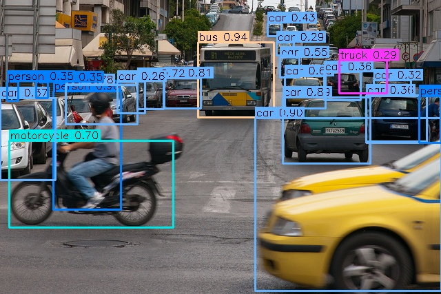
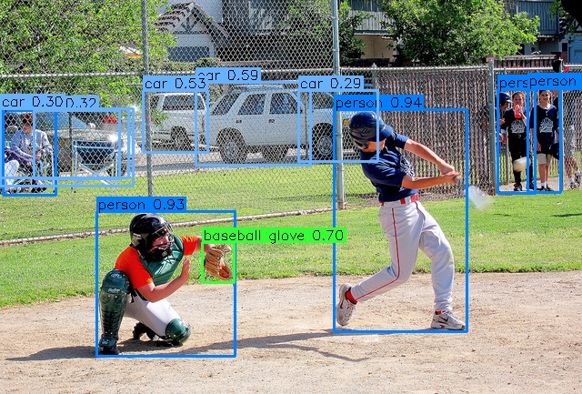
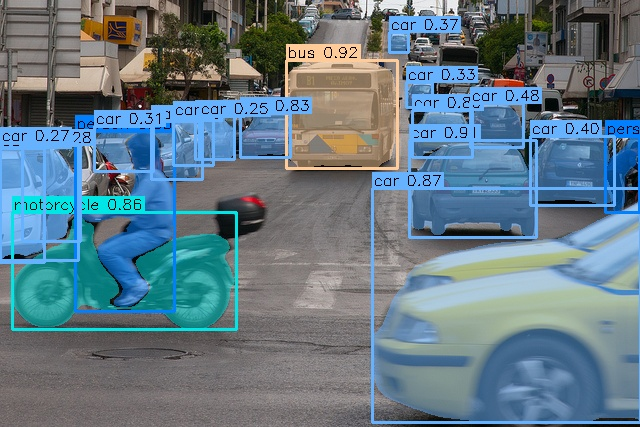
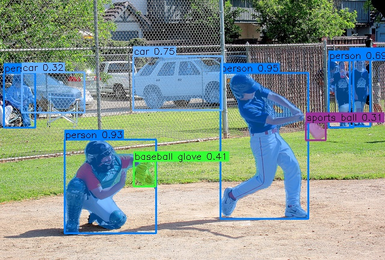

# Flash-YOLO

> ⚡ **A super-lightweight detection & segmentation framework — 31% fewer GFLOPs than YOLO26n
> for detection (18% for segmentation), millisecond GPU/CPU inference, and a complete independent
> pipeline: train (single-GPU / DDP) · evaluate · export · infer (image / video / stream).
> Raw dataset in, TensorRT engine out.**
>
> Core runtime is just PyTorch + NumPy — no monolithic abstractions, no ultralytics dependency.

<p align="center">
  <a href="CHANGELOG.md"></a>
  <a href="LICENSE"></a>
  <a href="https://www.python.org/downloads/"></a>
  <a href="https://pytorch.org/"></a>
</p>

<p align="center">
  
  
  <br>
  <em>Detections by the 100-epoch Flash-YOLO checkpoint — COCO val2017 samples, 640 input</em>
</p>

COCO val2017, official pycocotools (`scripts/eval.py`), 640 input. E2E = NMS-free default path;
NMS = one-to-many head + NMS. Official rows are Objects365 pretraining + COCO finetuning;
"from scratch" rows use the built-in baseline recipe for 100 epochs — not like for like.

| Model | Training | E2E mAP50-95 | E2E mAP50 | NMS mAP50-95 | NMS mAP50 | Params | GFLOPs |
|---|---|---:|---:|---:|---:|---:|---:|
| YOLO26n · official weights | O365 + COCO | **40.27** | 55.80 | **40.89** | 56.87 | 2.57M | 5.48 |
| YOLO26n · this repo | 100 ep from scratch | 36.22 | 51.32 | 37.15 | 52.67 | 2.57M | 5.48 |
| Flash-YOLO · this repo | 100 ep from scratch | 33.77 | 48.63 | 34.72 | 50.16 | 1.97M | 3.80 |
| **Δ (Flash-YOLO vs YOLO26n, same budget)** | | **−2.45 (−7%)** | **−2.69 (−5%)** | | | **−0.60M (−23%)** | **−1.68 (−31%)** |

<p align="center">
  
  
  <br>
  <em>Instance segmentation by the 100-epoch Flash-YOLO-seg checkpoint — same COCO val2017 samples, 640 input</em>
</p>

| Model | Training | Box mAP50-95 | Box mAP50 | Mask mAP50-95 | Mask mAP50 | Params | GFLOPs |
|---|---|---:|---:|---:|---:|---:|---:|
| YOLO26n-seg · official weights | O365 + COCO | **39.67** | 55.48 | **33.67** | 52.76 | 3.13M | 9.3 |
| YOLO26n-seg · this repo | 100 ep from scratch | 35.69 | 51.03 | 30.52 | 48.61 | 3.13M | 9.3 |
| Flash-YOLO-seg · this repo | 100 ep from scratch | 33.11 | 47.96 | 28.24 | 45.34 | 2.53M | 7.6 |
| **Δ (Flash-YOLO-seg vs YOLO26n-seg, same budget)** | | **−2.58 (−7.2%)** | **−3.07 (−6.0%)** | **−2.28 (−7.5%)** | **−3.27 (−6.7%)** | **−0.60M (−19%)** | **−1.7 (−18%)** |

- Official YOLO26n-seg training-time validator records 39.75 / 33.86 (Box / Mask mAP50-95);
  this pipeline reports 39.67 / 33.67 — a ~0.002 metric-implementation difference, not a model
  difference.
- Flash-YOLO-seg and YOLO26n-seg rows use the same recipe and budget (100 ep, batch 16, nbs 64,
  fp32); the 20-epoch ablation is in [docs/flash-yolo-seg-spec.md](docs/flash-yolo-seg-spec.md).
- Full latency (ORT-CPU / TensorRT fp32/fp16, b1/b8), deployment artifacts and provenance:
  [docs/weights.md](docs/weights.md).

## Table of Contents

- [Supported Models](#supported-models)
- [Installation](#installation)
- [Quick Start](#quick-start)
- [Usage](#usage)
  - [Detection](#detection)
  - [Segmentation](#segmentation)
- [Documentation](#documentation)
- [Citation](#citation)
- [License](#license)

## Supported Models

| Architecture | Task | Scale | Params | GFLOPs | Notes |
|---|---|---|---:|---:|---|
| YOLO26 | detection | n / s / m / l / x | 2.57M (n) | 5.48 (n) | official n checkpoint + from-scratch n validated |
| YOLO26-seg | segmentation | n / s / m / l / x | 3.13M (n) | 9.3 (n) | Box + Mask, COCO polygons / YOLO-seg txt |
| Flash-YOLO | detection | flash | 1.97M | 3.80 | this repo's lightweight design |
| Flash-YOLO-seg | segmentation | flash | 2.53M | 7.6 | same backbone/neck, Segment26 head |
| YOLOv3-tiny / -SiLU | detection | tiny | 8.85M | 5.56 @416 | darknet-compatible; official `.weights` for the original variant |

YOLOv3-tiny reference: official darknet weights evaluate at 17.16 / 35.90 (mAP50-95 / mAP50)
@640 through this pipeline. From-scratch 300-epoch runs at 416 reach **16.15 / 29.93** with the
current default recipe (SiLU + `--obj-iou-target`); the v0.6.0 recipe
(`--muon-w 0.528 --sgd-w 0.674`) reaches 16.52 / 30.44. See [docs/weights.md](docs/weights.md).

> YOLOv3-tiny's canonical input is **416** (darknet; the GFLOPs column is measured there).
> `config/train.yaml` keeps `imgsz: 640` for every architecture, so the v3 protocol needs
> `--imgsz 416` explicitly; from-scratch at 640 would also want re-clustered anchors.

## Installation

**Requirements:** Python 3.12 · PyTorch 2.x · NumPy · OpenCV. The core runtime is PyTorch + NumPy;
ONNX Runtime and TensorRT are only needed for the corresponding deployment engines.

```bash
git clone https://github.com/zjykzj/flash-yolo.git
cd flash-yolo
pip install -r requirements.txt
```

Optional development setup — runs the test suite and converts official checkpoints:

```bash
pip install -r requirements-dev.txt   # adds pytest + ultralytics (dev-time reference only)
python model/summary.py --model flash-yolo   # architecture sanity check, no data needed
pytest tests/ -q
```

A verified environment (Python 3.12, CUDA 13, TensorRT 11.4) is available as a Docker image:

```bash
docker build -t flash-yolo:dev .
docker/run.sh                          # interactive shell, repo mounted at /workspace
docker/run.sh pytest tests/            # run any command inside the container
```

See [docs/docker.md](docs/docker.md) for host requirements (NVIDIA driver ≥ 580, nvidia-container-toolkit).

## Quick Start

From a clean checkout to an annotated image — no dataset preparation, no ultralytics install.
Download a released checkpoint from [Releases](https://github.com/zjykzj/flash-yolo/releases) and
save it as `weights/flash-yolo.safetensors`.

```bash
# 1) run inference on the bundled sample
python scripts/infer.py --weights weights/flash-yolo.safetensors \
    --image assets/traffic.jpg

# 2) open the result
# -> runs/predict/predictN/traffic.jpg   (annotated image)
# -> runs/predict/predictN/labels/traffic.txt
```

Segmentation works the same way — save the released segmentation checkpoint as
`weights/flash-yolo-seg.safetensors` and the instance masks are overlaid:

```bash
python scripts/infer.py --weights weights/flash-yolo-seg.safetensors \
    --image assets/traffic.jpg
```

Video, camera and RTSP streams are supported by the same script:

```bash
python scripts/infer.py --weights weights/flash-yolo.safetensors \
    --video /path/to/video.mp4
python scripts/infer.py --weights weights/flash-yolo.safetensors \
    --video 0 --max-frames 300        # camera index / live stream
```

One-command export to ONNX (add `--trt` for a TensorRT engine):

```bash
python scripts/export.py --weights weights/flash-yolo.safetensors
# -> runs/export/flash-yolo.onnx
```

Other released checkpoints and their metrics: [docs/weights.md](docs/weights.md).

## Usage

Both tasks read datasets through the same descriptor mechanism. Point `--data coco` at your local
dataset root once:

```bash
cp config/datasets/coco.yaml config/datasets/local/coco.yaml   # then edit `path:`
```

YOLO-format descriptors, segmentation labels and conversions are covered in
[docs/dataset.md](docs/dataset.md).

### Detection

Supported architectures: **YOLO26** (n/s/m/l/x), **Flash-YOLO**, **YOLOv3-tiny / -SiLU**.

**Train**

```bash
# Flash-YOLO — this repo's lightweight architecture
python scripts/train.py --data coco --model flash-yolo --name flash-coco-e100 --batch 32 --workers 8

# YOLO26 (n by default; --scale s/m/l/x for other sizes)
python scripts/train.py --data coco --model yolo26 --name yolo26n-coco-e100 --batch 32 --workers 8

# YOLOv3-tiny — darknet protocol (canonical 416 input, passed explicitly)
python scripts/train.py --data coco --model yolov3-tiny --imgsz 416 --name v3tiny-coco-e300 --batch 32 --workers 8

# multi-GPU DDP: --batch is the GLOBAL batch (16 per GPU here), --workers is per GPU
python scripts/train.py --data coco --device 0,1 --batch 32 --workers 8

# resume (works across GPU counts / devices)
python scripts/train.py --data coco --device 0,1 --resume runs/train/train-<name>/resume.pt
```

Runs land in `runs/train/train-<name>/` (`best/last.safetensors`, `results.csv`, `diag/`, `samples/`).
From-scratch / finetune / recipes / DDP details: [docs/train.md](docs/train.md).

**Evaluate**

```bash
python scripts/eval.py --weights runs/train/train-flash-coco-e100/weights/best.safetensors --data coco
# E2E (NMS-free) by default; add --nms for the one-to-many + NMS path.
```

`--split`, `--limit`, `--imgsz` and metric details: [docs/val.md](docs/val.md).

**Export**

```bash
python scripts/export.py --weights runs/train/train-flash-coco-e100/weights/best.safetensors --trt
# --fp16 for half precision; --dynamic for a dynamic batch axis.
```

ONNX / TensorRT options and output contracts: [docs/export.md](docs/export.md).

**Infer**

```bash
python scripts/infer.py --weights runs/train/train-flash-coco-e100/weights/best.safetensors \
    --image assets/traffic.jpg          # file or directory
python scripts/infer.py --weights runs/train/train-flash-coco-e100/weights/best.safetensors \
    --video 0 --max-frames 300          # file / RTSP URL / camera index
```

Full engine and output notes: [docs/infer.md](docs/infer.md).

### Segmentation

Supported architectures: **YOLO26-seg** (n/s/m/l/x), **Flash-YOLO-seg**.

**Data**

COCO polygon annotations and YOLO-seg txt rows (`cls x1 y1 ...`) are both accepted; bbox-only
rows fall back to rectangles. Format details and the COCO converter:
[docs/dataset.md](docs/dataset.md).

**Train**

```bash
python scripts/train.py --data coco --model yolo26-seg --name seg-coco --batch 32 --workers 8
python scripts/train.py --data coco --model flash-yolo-seg --name flash-seg --batch 32 --workers 8

# official COCO-stage recipe (needs the 365-class O365 segmentation initialization)
python scripts/train.py --data coco --recipe yolo26-seg-coco-ft \
    --weights <objv1-seg.safetensors> --batch 32 --workers 8
```

Segmentation memory/throughput notes (`--mask-ratio`, `--overlap-mask`, batch sizing):
[docs/train.md](docs/train.md).

**Evaluate** — checkpoints produce Box and Mask tables automatically:

```bash
python scripts/eval.py --weights runs/train/train-seg-coco/weights/best.safetensors --data coco
```

**Export** — the model has two outputs (detections + mask prototypes):

```bash
python scripts/export.py --weights runs/train/train-flash-seg/weights/best.safetensors --trt
```

**Infer** — masks are overlaid on the image; labels are written as normalized polygons:

```bash
python scripts/infer.py --weights weights/flash-yolo-seg.safetensors \
    --image assets/traffic.jpg
```

Full engine and output notes: [docs/infer.md](docs/infer.md).

## Documentation

The full manual starts at [docs/README.md](docs/README.md): train / val / export / infer / dataset /
docker / FAQ, released weights and latency ([docs/weights.md](docs/weights.md)), and the
per-architecture specs (YOLO26, Flash-YOLO / -seg, YOLOv3-tiny).

## Citation

If you use the YOLO26 architecture or its training recipe in your work, please cite the YOLO26
paper. The YOLOv3-tiny variant follows the original YOLOv3 design (darknet cfg / `.weights`) —
cite the YOLOv3 paper when referring to that architecture.

```bibtex
@article{jocher2026yolo26,
  title   = {Ultralytics YOLO26: Unified Real-Time End-to-End Vision Models},
  author  = {Jocher, Glenn and Qiu, Jing and Liu, Mengyu and Lyu, Shuai and Akyon, Fatih Cagatay and Kalfaoglu, Muhammet Esat},
  journal = {arXiv preprint arXiv:2606.03748},
  year    = {2026},
  doi     = {10.48550/arXiv.2606.03748},
  url     = {https://arxiv.org/abs/2606.03748}
}
```

```bibtex
@article{redmon2018yolov3,
  title   = {YOLOv3: An Incremental Improvement},
  author  = {Redmon, Joseph and Farhadi, Ali},
  journal = {arXiv preprint arXiv:1804.02767},
  year    = {2018},
  doi     = {10.48550/arXiv.1804.02767},
  url     = {https://arxiv.org/abs/1804.02767}
}
```

## License

The code is licensed under **Apache-2.0** — see [LICENSE](LICENSE) for details.

- **Official YOLO26 weights** (AGPL-3.0) are not distributed here; download them with
  `scripts/download_weights.py` for personal use.
- **From-scratch detection checkpoints** are published as safetensors on
  [Releases](https://github.com/zjykzj/flash-yolo/releases); the exact list, profiles and the
  segmentation status (local-only for now) are in [docs/weights.md](docs/weights.md).
