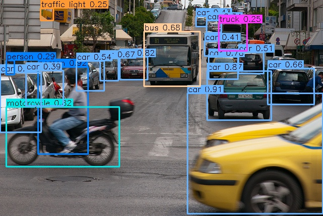
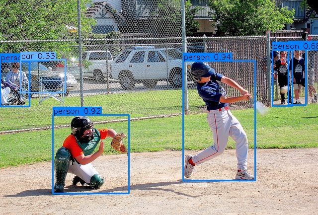

# Flash-YOLO

> ⚡ **Flash-YOLO: a super-lightweight architecture, 31% fewer GFLOPs than YOLO26n. Millisecond inference on GPU and CPU — all inside a complete, independent framework: train · evaluate · export · infer, raw dataset in, TensorRT engine out.**
>
> No monolithic abstractions, no heavyweight dependencies — core runtime is just PyTorch + NumPy.

<p align="center">
  <a href="CHANGELOG.md"></a>
  <a href="LICENSE"></a>
  <a href="https://www.python.org/downloads/"></a>
  <a href="https://pytorch.org/"></a>
</p>

<p align="center">
  
  
  <br>
  <em>Detections by the 100-epoch flash-yolo checkpoint — COCO val2017 samples, 640 input</em>
</p>

**Accuracy & size** — COCO val2017, official pycocotools (`scripts/eval.py`), E2E (NMS-free) at 640:

| Model | mAP@[.5:.95] | mAP@50 | Params | GFLOPs @640 |
|---|---|---|---|---|
| YOLO26n · official weights | 40.27 | 55.80 | 2.57M | 5.48 |
| YOLO26n · this repo, 100 ep | 36.22 | 51.32 | 2.57M | 5.48 |
| flash-yolo · this repo, 100 ep¹ | 33.77 | 48.63 | 1.97M | 3.80 |
| **Δ (flash-yolo vs YOLO26n)** | **−2.45 (−7%)** | **−2.69 (−5%)** | **−0.60M (−23%)** | **−1.68 (−31%)** |

**Latency²** — model-only inference stage; ONNX Runtime on an Intel Xeon Platinum 8470Q (25-core
container quota), TensorRT on one RTX 5090. Measured from the released checkpoints on an idle
machine (host load ≈13): ORT-CPU cells are the best-case `min` of 300 samples per model³;
TensorRT cells are the best-case `min` over repeated runs².

| Model | ORT-CPU b1 (ms) | ORT-CPU b8 (ms/img) | TRT b1 fp32 (ms) | TRT b1 fp16 (ms) | TRT b8 fp32 (ms/img) | TRT b8 fp16 (ms/img) |
|---|---|---|---|---|---|---|
| YOLO26n · official weights | 14.6³ | 6.86³ | 1.37 | 1.28 | 0.245 | 0.135 |
| YOLO26n · this repo, 100 ep | 14.6³ | 6.86³ | 1.37 | 1.28 | 0.245 | 0.135 |
| flash-yolo · this repo, 100 ep | 13.2³ | 5.84³ | 1.31 | 1.27 | 0.210 | 0.123 |
| **Δ (flash-yolo vs YOLO26n)** | **−1.4 (−9%)** | **−1.02 (−15%)** | **−0.06 (−4%)** | **−0.01 (−1%)** | **−0.035 (−14%)** | **−0.012 (−9%)** |

¹ flash-yolo — a single-variable screened YOLO26 variant that keeps all three detection levels (P3/P4/P5) — trained from scratch for 100 epochs, same recipe, data and budget as the from-scratch YOLO26n row above, so its Δ is like for like; with NMS: 34.72 / 50.16. ² TensorRT rows: engines built from the released checkpoints (`runs/release-weights/<model>.{engine,fp16.engine}`; full profile in [docs/weights.md](docs/weights.md)), best-case `min` over 180 timed runs (b1) and 30 single-shot + 100 pipelined runs (b8); b1 fp16 ties at ~1.3 ms for both models — the b1 chain that is exactly verified is fp32 (`pt → onnx → engine`). Δ compares against the budget-matched from-scratch YOLO26n; for structure and latency both YOLO26n rows are identical. Details: [YOLO26n alignment](#yolo26n-alignment-with-the-official-weights). ³ ORT-CPU rows: idle container on a shared host (host load ≈ 13 during the session) — each cell is the best-case `min` of 300 samples per model (`runs/artifacts/bench/release_bench_ort.py`), b1 on the fixed-batch export and b8 on the dynamic-batch graph. Neighbour load moves absolute values between sessions (earlier sessions at load ≈ 40 read b8 8.27 / 6.09), and b1 is per-run-overhead-bound; the b8 column tracks the 1.44× GFLOP ratio and is the one that separates the architectures.

**Trained weights** — the from-scratch checkpoints behind the "this repo" rows above are attached to
[Releases](https://github.com/zjykzj/flash-yolo/releases) as safetensors; the full accuracy/latency
profile of every published checkpoint lives in [docs/weights.md](docs/weights.md).

## Quick Start

```bash
pip install -r requirements.txt
python model/summary.py --model flash-yolo   # sanity check: architecture table, no data needed
```

Datasets are described by a small yaml. The shipped COCO template needs only its `path` filled in —
copy it into the gitignored `local/` directory and `--data coco` resolves to it
(`--data path/to/x.yaml` also works):

```bash
cp config/datasets/coco.yaml config/datasets/local/coco.yaml   # then edit `path:`
```

```yaml
format: coco                 # coco (json annotations) | yolo (labels/*.txt)
path: /path/to/coco          # the one machine-specific line
names: [person, bicycle, ...]  # 80 names; index = class id (the template ships the full list)
train: {images: images/train2017, ann: annotations/instances_train2017.json}
val:   {images: images/val2017,   ann: annotations/instances_val2017.json}
```

Then each of the four workflows is one command away — the chain below trains this repo's own
lightweight model and carries that one checkpoint through all four:

### Train — flash-yolo from scratch

```bash
# the repo's own lightweight architecture (3.80 GFLOPs @640, 1.97M params); ~15.5 h on one RTX 5090
python scripts/train.py --data coco --model flash-yolo --name flash-coco-e100 --batch 64 --workers 16
# -> runs/train/flash-coco-e100/   (best.safetensors · results.csv · diag/ · samples/ · run.log)
```

`--name` is optional — it only names the run dir (`train-<name>`; without it you get
`runs/train/train`, then `train2`, `train3`, …).

Instance segmentation is supported end to end as well:

```bash
python scripts/train.py --data coco --model yolo26-seg --name seg-coco --batch 64 --workers 16
# official COCO-stage recipe (needs Objects365 seg initialization, 365 -> 80 classes):
python scripts/train.py --data coco --recipe yolo26-seg-coco-ft --weights <objv1-seg.safetensors>
```

Segmentation training accepts COCO json polygons or YOLO-seg txt; the resulting checkpoint then
evaluates with Box + Mask tables, exports a two-output ONNX/TensorRT graph, and infers masks
through the same three engines. Details: [docs/train.md](docs/train.md).

### Evaluate — formal pycocotools numbers

```bash
python scripts/eval.py --weights runs/train/flash-coco-e100/weights/best.safetensors --data coco
# -> 33.77 mAP@[.5:.95] / 48.63 mAP@50 on COCO val2017 (E2E)   ·   add --nms -> 34.72 / 50.16
```

### Export — onnx, then a TensorRT engine

```bash
python scripts/export.py --weights runs/train/flash-coco-e100/weights/best.safetensors --trt
# -> runs/export/*.onnx + *.engine   (add --fp16 for the half-precision build; drop --trt to get
#                                     the onnx alone — TensorRT is an optional dependency)
```

### Inference — three runtimes, one contract

```bash
# E2E NMS-free by default; --engine onnx|trt switches runtime; --image takes a file or a directory
python scripts/infer.py --weights runs/train/flash-coco-e100/weights/best.safetensors --image assets/traffic.jpg
# -> annotated image + YOLO-txt labels under runs/predict/
```

## YOLO26n alignment with the official weights

All numbers: COCO val2017, official pycocotools (`scripts/eval.py`), 640 input. E2E = the NMS-free
default path; NMS = the one-to-many head + NMS. The `ultralytics` rows use the identical pipeline —
same preprocessing, postprocessing, pycocotools evaluation and hardware; only the code that runs the
forward pass differs.

| Model | Implementation | Training | mAP@[.5:.95] | mAP@50 | Params | GFLOPs @640 |
|---|---|---|---|---|---|---|
| YOLO26n · official weights · E2E (NMS-free) | this repo | Objects365 pretrain (150 ep) + COCO finetune (245 ep), published | **40.27** | 55.80 | 2.57M | 5.48 |
| YOLO26n · official weights · E2E (NMS-free) | ultralytics¹ | same checkpoint | 40.27 | 55.80 | 2.57M | 5.48 |
| YOLO26n · official weights · NMS (o2m) | this repo | same checkpoint | **40.89** | 56.87 | 2.57M | 5.48 |
| YOLO26n · official weights · NMS (o2m) | ultralytics¹ | same checkpoint | 40.89 | 56.87 | 2.57M | 5.48 |
| YOLO26n · this repo, from scratch, 100 ep · E2E (NMS-free)² | this repo | baseline recipe, fp32, one RTX 5090, ~14 h | **36.22** | 51.32 | 2.57M | 5.48 |
| YOLO26n · this repo, from scratch, 100 ep · NMS (o2m)² | this repo | same run | **37.15** | 52.67 | 2.57M | 5.48 |

```bash
# official rows: download + convert + evaluate (~10 min, no training; AGPL-3.0 weights, personal
# research / verification use — the conversion writes pure safetensors, the runtime never imports ultralytics)
python scripts/download_weights.py --model yolo26n
python scripts/convert_weights.py --src weights/yolo26n.pt --dst weights/yolo26n.safetensors
python scripts/eval.py --weights weights/yolo26n.safetensors --data coco        # 40.27 / 55.80
python scripts/eval.py --weights weights/yolo26n.safetensors --data coco --nms  # 40.89 / 56.87

# optional cross-check — the same weights run by the ultralytics implementation on this repo's
# pipeline (dev-time only: pip install -r requirements-dev.txt)
python scripts/compare_official.py --data coco        # 40.27 / 55.80
python scripts/compare_official.py --data coco --nms  # 40.89 / 56.87

# from-scratch row: the built-in baseline recipe, ~14 h on one RTX 5090
python scripts/train.py --data coco --name yolo26n-from-scratch --batch 64 --workers 16
python scripts/eval.py --weights runs/train/yolo26n-from-scratch/weights/best.safetensors --data coco        # 36.22 / 51.32
python scripts/eval.py --weights runs/train/yolo26n-from-scratch/weights/best.safetensors --data coco --nms  # 37.15 / 52.67
```

- ¹ The ultralytics implementation of the same checkpoint, run through this repo's pipeline (`scripts/compare_official.py`) — every number, P/R included, matches the row above it exactly: with identical weights the two implementations are interchangeable. The published 40.1 / 40.9 come from the official metric implementation; the ~0.1 delta to these rows is metric-implementation noise, not a model difference.
- ² From scratch: COCO train2017, random init, built-in baseline recipe (100 epochs, fp32, ~14 h). Not like for like with the rows above: every official checkpoint starts from Objects365 pretraining.

## Verification

The reproduction and parity claims throughout this README are load-bearing, so each one has an
executable check behind it — most live in the 184-test suite (176 tests + 8 env-gated). Checks that
compare against the official implementation run at dev time only (requirements-dev.txt; the runtime
never imports ultralytics).

- **Bit-identical reproduction** — the official checkpoint (260 layers · 2,572,280 params) loads
  with zero key mapping (`strict=True`, which only succeeds when the module tree matches exactly)
  and the inference output is bit-for-bit identical to the official model on the same input. The
  "Official" rows in [YOLO26n alignment](#yolo26n-alignment-with-the-official-weights) are that
  model re-run through this pipeline — identical numbers.
- **Training is bit-reproducible** — the default `--deterministic` (cuDNN autotune off,
  deterministic kernels, per-epoch augmentation RNG replay) makes the same seed produce
  bit-identical weights on the same machine, and a resumed run bit-identical to an uninterrupted
  one; `FLASH_YOLO_REPRO=1` gates the CPU/GPU two-run + resume-equivalence checks (0 bit difference).
- **Training internals match** — same weights, same real batch, this implementation vs the
  official one: total loss within <1%, gradient norm within <2%.
- **Augmentation is pixel-exact** — mosaic canvas, affine output and the resampled labels were
  verified against the official pipeline with 0 pixel / 0 label difference.
- **Every runtime agrees** — pt ↔ onnx: raw output < 5e-4, E2E detections < 1e-3; a TensorRT fp32
  engine is within 2e-3 of PyTorch; an fp16 engine is bit-identical to the PyTorch half model on
  raw outputs.
- **Both data formats agree** — the COCO-json and YOLO-txt loaders produce identical boxes on the
  same images (0 difference), and identical training-side statistics.

## Project Structure

```
assets/    demo images (traffic.jpg / baseball.jpg + rendered detections; provenance in assets/README.md)
config/    inference/eval defaults (inference.py) + model structures (models/yolo26.yaml,
           models/flash-yolo.yaml)
           + dataset descriptors (datasets/<name>.yaml + spec.py loader; local/ = gitignored
           machine paths) + training config (train.yaml + TrainConfig in train_config.py
           + recipes/: yolo26-coco-ft, yolo26-o365-pt)
data/      COCO / YOLO readers (coco.py · yolo.py · build.py factory · scan.py shared scan types)
           + training pipeline (loader.py: augment entry, collate, worker contracts)
eval/      COCO evaluation (pycocotools wrapper)
logs/      logs of scripts without a run dir (gitignored; run-dir scripts write <run>/run.log)
model/     model implementation (yaml factory build.py + arch registry / dual Detect head /
           basic operator layer / weight loading)
runs/      runtime results (gitignored)
scripts/   download_weights / convert_weights / compute_anchors / make_coco_subset / infer /
           export / eval / train / bench_io / compare_official
tests/     176 tests + 8 env-gated (FLASH_YOLO_SMOKE / FLASH_YOLO_REPRO): weight alignment / export parity / metric correctness / training
           components
train/     training: TAL+STAL assigner / dual-head ProgLoss / MuSGD / EMA / trainer / FastMetrics
           (+ per-run artifacts: periodic checkpoints, gradient diag CSV, augment samples, meta.json)
utils/     anchors & decode / postprocessing (NMS) / pt·onnx·TensorRT engines / visualization / IoU /
           logger (dual console+file) / progress bar / paths (runs/ increment)
```

## Tests

```bash
pytest tests/    # 176 tests + 8 env-gated (FLASH_YOLO_SMOKE / FLASH_YOLO_REPRO): weight alignment / export parity / metric correctness / training components (assigner, loss, MuSGD, EMA, checkpoint, augment geometry, config, FastMetrics) + coco/yolo format equivalence + weights metadata + TensorRT fp32/fp16 engines
```

`tests/test_weight_alignment.py` compares against the official .pt as a dev-time reference — install requirements-dev.txt to run it.

## 📄 License

The code is licensed under **Apache-2.0** — see [LICENSE](LICENSE) for details.

- **Pretrained weights**: the official YOLO26 weights (AGPL-3.0) are not distributed here — download them via `scripts/download_weights.py` for personal use
- **Trained weights**: this repo's from-scratch checkpoints (flash-yolo 100 ep, YOLO26n 100 ep) are published as safetensors on the [Releases](https://github.com/zjykzj/flash-yolo/releases) page
