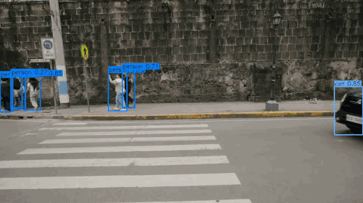
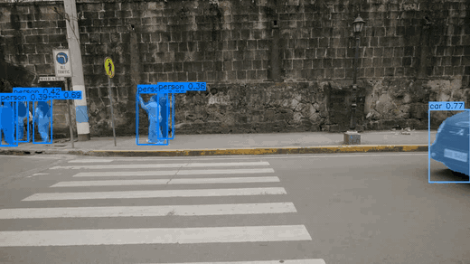
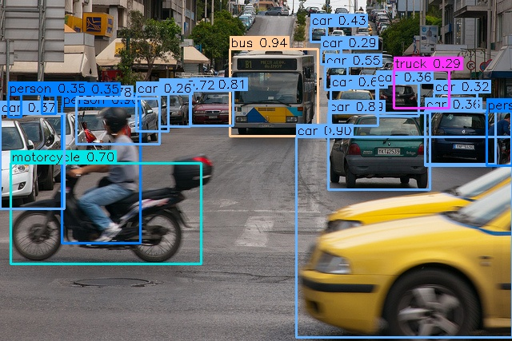
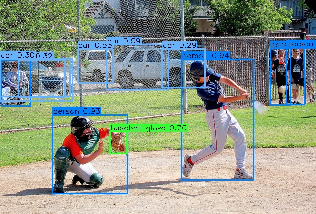
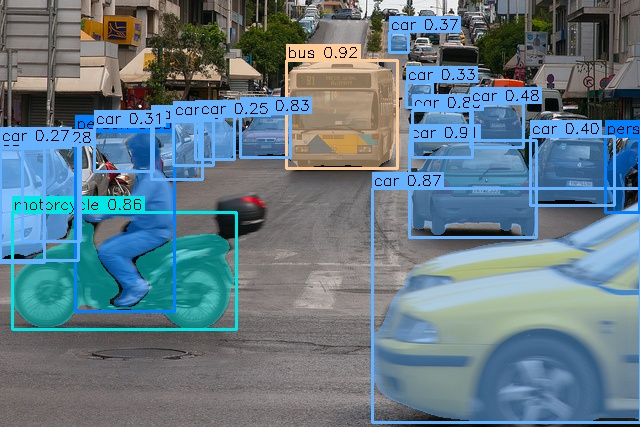
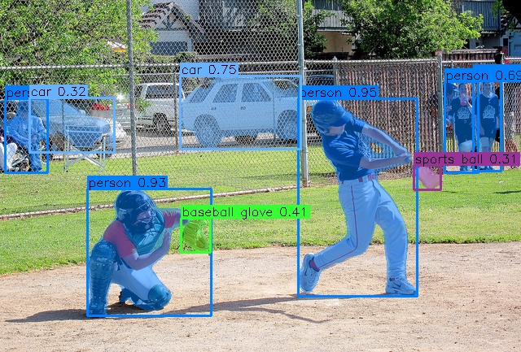
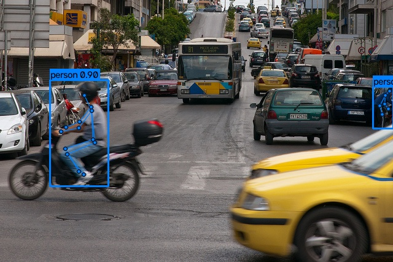
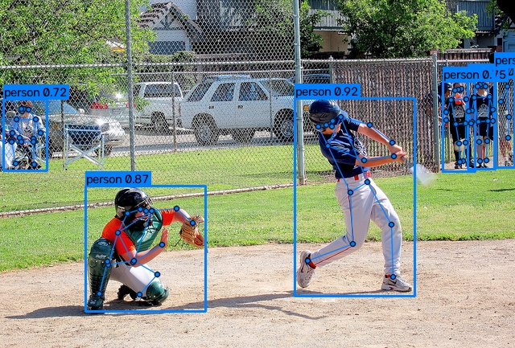
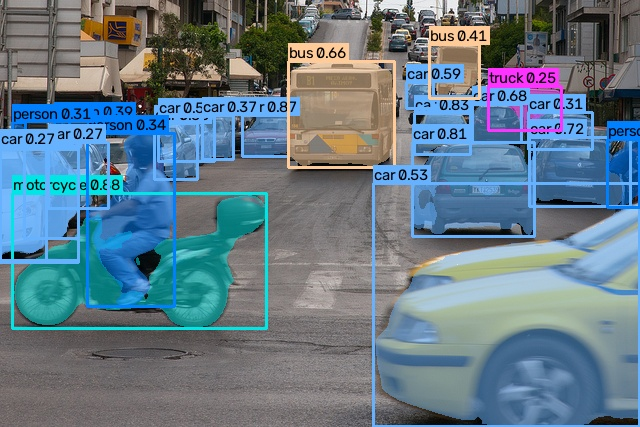
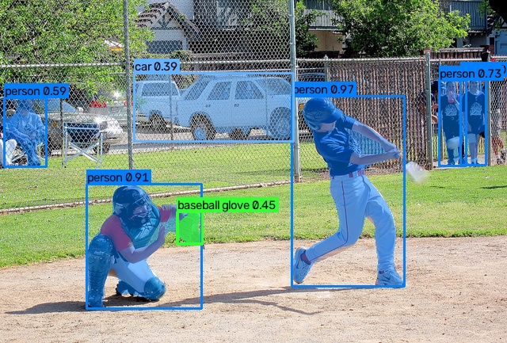

# Flash-YOLO

> ⚡ **超轻量检测与分割框架——检测 GFLOPs 比 YOLO26n 低 31%（分割低 18%），GPU/CPU 毫秒级推理，
> 以及一条完整独立的流水线：训练（单卡 / DDP）· 评估 · 导出 · 推理（图片 / 视频 / 流）。
> 原始数据集进，TensorRT 引擎出。**
>
> 核心运行时只有 PyTorch + NumPy——没有庞杂抽象，没有额外安装。

<p align="center">
  <a href="LICENSE"></a>
  <a href="CHANGELOG.md"></a>
  <a href="https://www.python.org/downloads/"></a>
  <a href="https://pytorch.org/"></a>
  <a href="https://github.com/zjykzj/flash-yolo/actions/workflows/tests.yml"></a>
</p>

<p align="center">
  
  
  <br>
  <em>Flash-YOLO 检测（左）与 Flash-YOLO-seg 实例分割（右），同一段街景视频——640 输入</em>
</p>

COCO val2017，官方 pycocotools（`scripts/eval.py`），640 输入。E2E = NMS-free 默认路径；
NMS = one-to-many 头 + NMS。官方行为 Objects365 预训练 + COCO 微调；
"from scratch" 行使用内置基线配方训练 300 轮——与官方不是 like for like。

| 模型 | 训练 | E2E mAP50-95 | E2E mAP50 | NMS mAP50-95 | NMS mAP50 | Params | GFLOPs |
|---|---|---:|---:|---:|---:|---:|---:|
| YOLO26n · 官方权重 | O365 + COCO | **40.27** | 55.80 | **40.89** | 56.87 | 2.57M | 5.48 |
| YOLO26n · 本仓库 | 从零 300 轮 | **37.82** | **53.24** | **38.65** | **54.46** | 2.57M | 5.48 |
| Flash-YOLO · 本仓库 | 从零 300 轮 | **35.14** | **50.15** | **36.09** | **51.56** | 1.97M | 3.80 |
| **Δ（Flash-YOLO vs YOLO26n，同预算）** | | **−2.68（−7.1%）** | **−3.09（−5.8%）** | **−2.56（−6.6%）** | **−2.90（−5.3%）** | **−0.60M（−23%）** | **−1.68（−31%）** |

- 以上为 300 轮从零训练（batch 32、nbs 64、fp32、单卡）。

| 模型 | 训练 | Box mAP50-95 | Box mAP50 | Mask mAP50-95 | Mask mAP50 | Params | GFLOPs |
|---|---|---:|---:|---:|---:|---:|---:|
| YOLO26n-seg · 官方权重 | O365 + COCO | **39.67** | 55.48 | **33.67** | 52.76 | 3.13M | 9.3 |
| YOLO26n-seg · 本仓库 | 从零 300 轮 | **37.90** | **53.69** | **32.37** | **51.16** | 3.13M | 9.3 |
| Flash-YOLO-seg · 本仓库 | 从零 300 轮 | **35.05** | **50.74** | **29.98** | **48.14** | 2.53M | 7.6 |
| **Δ（Flash-YOLO-seg vs YOLO26n-seg，同预算）** | | **−2.85（−7.5%）** | **−2.95（−5.5%）** | **−2.39（−7.4%）** | **−3.02（−5.9%）** | **−0.60M（−19%）** | **−1.7（−18%）** |

- 官方 YOLO26n-seg 的训练期 validator 记录 39.75 / 33.86（Box / Mask mAP50-95）；
  本管线报告 39.67 / 33.67——约 0.002 的差是指标实现差异，不是模型差异。
- 两个从零行使用同一配方与预算（300 轮、batch 32、nbs 64、fp32）；
  模型细节见 [docs/zh/models/flash-yolo-seg.md](docs/zh/models/flash-yolo-seg.md)。
- 部署产物与出处：[docs/zh/models/README.md](docs/zh/models/README.md)。

Pose 使用 COCO-pose val2017 协议（**2,346 张有有效关键点的图**，pycocotools OKS，
maxDets=20）：

| 模型 | 训练 | E2E AP | E2E AP50 | NMS AP | NMS AP50 | Params | GFLOPs |
|---|---|---:|---:|---:|---:|---:|---:|
| YOLO26n-pose · 官方权重 | O365 + 400 COCO-pose | **0.5687** | **0.8250** | **0.5670** | **0.8280** | 3.68M | 7.6 |
| YOLO26n-pose · 本仓库 | 从零 300 轮 | **0.5529** | **0.8200** | **0.5541** | **0.8249** | 3.68M | 7.6 |
| Flash-YOLO-pose · 本仓库 | 从零 300 轮 | **0.5004** | **0.7832** | **0.5055** | **0.7884** | 3.08M | 5.9 |
| **Δ（Flash-YOLO-pose vs YOLO26n-pose，同预算）** | | **−5.25（−9.5%）** | **−3.68（−4.5%）** | **−4.86（−8.8%）** | **−3.65（−4.4%）** | **−0.60M（−16%）** | **−1.7（−22%）** |

- COCO-pose val2017 只评估 **2,346 张有有效关键点的图**（不是检测的 5,000 张）；pycocotools
  OKS，maxDets=20。官方 pose checkpoint 是 O365 预训练 + 400 轮 COCO-pose，从零行与其
  不是 like-for-like。

**推理延迟**——model-only，640 输入（ORT-CPU = Xeon 8470Q · fp32；TRT = RTX 5090 · fp16；
b8 = batch 8 每图平均）。完整口径与逐模型表格：
[docs/zh/models/README.md](docs/zh/models/README.md)。

| 模型 | ORT-CPU b1 | ORT-CPU b8 | TRT fp16 b8 |
|---|---:|---:|---:|
| YOLO26n | 14.6 ms | 6.86 ms | 0.135 ms |
| Flash-YOLO | 13.2 ms | 5.84 ms | 0.123 ms |
| Δ | −10% | −15% | −9% |
| YOLO26n-seg | 16.8 ms | 12.0 ms | 0.148 ms |
| Flash-YOLO-seg | 14.9 ms | 10.8 ms | 0.136 ms |
| Δ | −11% | −10% | −8% |

## 目录

- [支持模型](#支持模型)
- [安装](#安装)
- [快速开始](#快速开始)
- [用法](#用法)
  - [检测](#检测)
  - [分割](#分割)
  - [姿态估计](#姿态估计)
  - [开放词汇（YOLOE-26）](#开放词汇yoloe-26)
- [文档](#文档)
- [贡献](#贡献)
- [引用](#引用)
- [许可](#许可)

## 支持模型

| 架构 | 任务 | 档位 | Params | GFLOPs | 备注 |
|---|---|---|---:|---:|---|
| YOLO26 | 检测 | n / s / m / l / x | 2.57M (n) | 5.48 (n) | 官方 n 档 checkpoint + 本仓库 n 档从零已验证 |
| YOLO26-seg | 分割 | n / s / m / l / x | 3.13M (n) | 9.3 (n) | Box + Mask，COCO 多边形 / YOLO-seg txt |
| YOLO26-pose | 姿态估计（COCO 17 关键点） | n / s / m / l / x | 3.68M (n) | 7.6 (n) | 官方权重前向逐位一致；300 轮从零已验证 |
| Flash-YOLO | 检测 | flash | 1.97M | 3.80 | 本仓库的轻量设计 |
| Flash-YOLO-seg | 分割 | flash | 2.53M | 7.6 | 同 backbone/neck，Segment26 头 |
| Flash-YOLO-pose | 姿态估计（COCO 17 关键点） | flash | 3.08M | 5.9 | 同 backbone/neck，Pose26 头；300 轮从零 E2E 0.5004 |
| YOLOv3-tiny / -SiLU | 检测 | tiny | 8.85M | 5.56 @416 | darknet 兼容；官方 `.weights` 只配原版 |
| YOLOE-26 | 开放词汇分割（pf / 文本 / 视觉提示词） | n / s / m / l / x | 7.84M (n) | 16.0 (n) | 官方 checkpoint（-pf 与文本/视觉模式），前向逐位一致 |

YOLOv3-tiny 参考：官方 darknet 权重经本管线在 @640 评估为 17.16 / 35.90（mAP50-95 / mAP50）。
从零 300 轮在 416 用当前默认配方（SiLU + `--obj-iou-target`）达到 **16.15 / 29.93**。详见
[docs/zh/models/yolov3-tiny.md](docs/zh/models/yolov3-tiny.md)。

> YOLOv3-tiny 的规范输入是 **416**（darknet；GFLOPs 列在该尺寸测量）。
> `config/train.yaml` 对所有架构保留 `imgsz: 640`，所以 v3 协议需要显式 `--imgsz 416`；
> 从零训练用 640 还应重聚类锚点。

YOLO26-pose 参考：官方 `yolo26n-pose` 权重经本管线在 COCO-pose val2017（2,346 图）达到
pose AP **0.5687** / AP50 **0.8250**（E2E；NMS 0.5670 / 0.8280），同数据 ultralytics 为
E2E 0.572 / 0.833、NMS 0.570 / 0.831。官方 pose checkpoint 是 O365 检测预训练 + COCO-pose
400 轮；从零训练不是 like-for-like。从零 300 轮 E2E 0.5529 / NMS 0.5541。详见
[docs/zh/models/yolo26-pose.md](docs/zh/models/yolo26-pose.md)。

Flash-YOLO-pose（flash-yolo backbone/neck + Pose26 头，3.08M / 5.9 GFLOPs）从零 300 轮达到
E2E **0.5004** / NMS **0.5055**，同预算下比 yolo26n-pose 低约 5 AP，参数少 16%。见
[docs/zh/models/flash-yolo-pose.md](docs/zh/models/flash-yolo-pose.md)。

## 安装

**要求：** Python 3.12 · PyTorch 2.x · NumPy · OpenCV。核心运行时为 PyTorch + NumPy；
ONNX Runtime 与 TensorRT 仅对应部署引擎需要。

```bash
git clone https://github.com/zjykzj/flash-yolo.git
cd flash-yolo
pip install -r requirements.txt
```

可选开发环境——跑测试套件与官方 checkpoint 转换：

```bash
pip install -r requirements-dev.txt   # adds pytest + ultralytics (dev-time reference only)
python model/summary.py --model flash-yolo   # 结构自检，无需数据
pytest tests/ -q
```

已验证环境（Python 3.12、CUDA 13、TensorRT 11.4）以 Docker 镜像提供：

```bash
docker build -t flash-yolo:dev .
docker/run.sh                          # 交互式 shell，仓库挂载在 /workspace
docker/run.sh pytest tests/            # 在容器内执行任意命令
```

宿主要求（NVIDIA 驱动 ≥ 580、nvidia-container-toolkit）见
[docs/zh/docker.md](docs/zh/docker.md)。

## 快速开始

从干净 checkout 到带标注的图片——无需准备数据集、无需训练。从
[Releases](https://github.com/zjykzj/flash-yolo/releases) 下载 `flash-yolo-e300-640.safetensors`
到仓库根目录。

```bash
# 1) 对内置样例跑推理
python scripts/infer.py --weights flash-yolo-e300-640.safetensors \
    --image assets/traffic.jpg

# 2) 打开结果
# -> runs/predict/predictN/traffic.jpg   （标注图片）
# -> runs/predict/predictN/labels/traffic.txt
```

分割用法相同——换用 `flash-yolo-seg-e300-640.safetensors`，实例掩码直接叠加：

```bash
python scripts/infer.py --weights flash-yolo-seg-e300-640.safetensors \
    --image assets/traffic.jpg
```

同一个脚本支持视频、相机与 RTSP 流：

```bash
python scripts/infer.py --weights flash-yolo-e300-640.safetensors \
    --video /path/to/video.mp4
python scripts/infer.py --weights flash-yolo-e300-640.safetensors \
    --video 0 --max-frames 300        # 相机索引 / 实时流
```

一行命令导出 ONNX（加 `--trt` 出 TensorRT 引擎）：

```bash
python scripts/export.py --weights flash-yolo-e300-640.safetensors
# -> runs/export/flash-yolo-e300-640.onnx
```

其他已发布 checkpoint 及其指标：[docs/zh/models/README.md](docs/zh/models/README.md)。

## 用法

两种任务通过同一描述符机制读数据。先把 `--data coco` 指到本地数据集根：

```bash
cp config/datasets/coco.yaml config/datasets/local/coco.yaml   # 然后编辑 `path:`
```

YOLO 格式描述符、分割标注与转换见
[docs/zh/datasets/README.md](docs/zh/datasets/README.md)。

### 检测

支持的架构：**YOLO26**（n/s/m/l/x）、**Flash-YOLO**、**YOLOv3-tiny / -SiLU**。

**训练**

```bash
# Flash-YOLO——本仓库的轻量架构
python scripts/train.py --data coco --model flash-yolo --name flash-coco-e300 --batch 32 --workers 8

# YOLO26（默认 n 档；其他档位 --scale s/m/l/x）
python scripts/train.py --data coco --model yolo26 --name yolo26n-coco-e300 --batch 32 --workers 8

# 多卡 DDP：--batch 是全局 batch（此处每卡 16），--workers 是每卡
python scripts/train.py --data coco --device 0,1 --batch 32 --workers 8

# 续训（可跨卡数 / 跨设备）
python scripts/train.py --data coco --device 0,1 --resume runs/train/train-<name>/resume.pt
```

产物落在 `runs/train/train-<name>/`（`best/last.safetensors`、`results.csv`、`diag/`、`samples/`）。
从零 / 微调 / DDP 细节：[docs/zh/pipeline/train.md](docs/zh/pipeline/train.md)。

**评估**

```bash
python scripts/eval.py --weights flash-yolo-e300-640.safetensors --data coco
# 默认 E2E（NMS-free）；加 --nms 走 one-to-many + NMS 路径。
```

`--split`、`--limit`、`--imgsz` 与指标细节：[docs/zh/pipeline/eval.md](docs/zh/pipeline/eval.md)。

**导出**

```bash
python scripts/export.py --weights flash-yolo-e300-640.safetensors --trt
# --fp16 半精度；--dynamic 动态 batch 轴。
```

ONNX / TensorRT 选项与输出契约：[docs/zh/pipeline/export.md](docs/zh/pipeline/export.md)。

**推理**

```bash
python scripts/infer.py --weights flash-yolo-e300-640.safetensors \
    --image assets/traffic.jpg          # 文件或目录
python scripts/infer.py --weights flash-yolo-e300-640.safetensors \
    --video 0 --max-frames 300          # 文件 / RTSP URL / 相机索引
```

完整引擎与输出说明：[docs/zh/pipeline/infer.md](docs/zh/pipeline/infer.md)。

<p align="center">
  
  
  <br>
  <em>300 轮 Flash-YOLO checkpoint 的检测结果——COCO val2017 样例，640 输入</em>
</p>

### 分割

支持的架构：**YOLO26-seg**（n/s/m/l/x）、**Flash-YOLO-seg**。

**数据**

COCO 多边形标注与 YOLO-seg txt 行（`cls x1 y1 ...`）都接受；纯 bbox 行回退为矩形。
格式细节与 COCO 转换器：[docs/zh/datasets/README.md](docs/zh/datasets/README.md)。

**训练**

```bash
python scripts/train.py --data coco --model yolo26-seg --name seg-coco --batch 32 --workers 8
python scripts/train.py --data coco --model flash-yolo-seg --name flash-seg --batch 32 --workers 8
```

分割显存/吞吐说明（`--mask-ratio`、`--overlap-mask`、batch 选型）：
[docs/zh/pipeline/train.md](docs/zh/pipeline/train.md)。

**评估**——checkpoint 自动产出 Box 与 Mask 两张表：

```bash
python scripts/eval.py --weights flash-yolo-seg-e300-640.safetensors --data coco
```

**导出**——模型双输出（检测 + 掩码原型）：

```bash
python scripts/export.py --weights flash-yolo-seg-e300-640.safetensors --trt
```

**推理**——掩码叠加在图上；标签写成归一化多边形：

```bash
python scripts/infer.py --weights flash-yolo-seg-e300-640.safetensors \
    --image assets/traffic.jpg
```

完整引擎与输出说明：[docs/zh/pipeline/infer.md](docs/zh/pipeline/infer.md)。

<p align="center">
  
  
  <br>
  <em>300 轮 Flash-YOLO-seg checkpoint 的实例分割——同一批 COCO val2017 样例，640 输入</em>
</p>

### 姿态估计

支持的架构：**YOLO26-pose**（n/s/m/l/x）与 **Flash-YOLO-pose**（flash 单档）；数据用
COCO keypoints json（`person_keypoints_*.json`，17 点，`nc=1`），描述符模板
`config/datasets/coco-pose.yaml`。COCO-pose 的 val 协议是 **2,346 张有有效关键点的图**，
不是检测的 5,000 张。

```bash
# 训练（官方 400 轮配方；微调从官方 pose 权重开始）
python scripts/train.py --data coco-pose --model yolo26-pose \
    --weights weights/yolo26n-pose.safetensors \
    --recipe yolo26-pose-coco --epochs 10 --batch 32 --device 0

# Flash-YOLO-pose 从零训练（default 配方）
python scripts/train.py --data coco-pose --model flash-yolo-pose \
    --name flash-pose --batch 32 --device 0 --no-amp

# 评估（E2E / NMS）、导出、推理
python scripts/eval.py --weights weights/yolo26n-pose.safetensors --data coco-pose
python scripts/export.py --weights weights/yolo26n-pose.safetensors --trt --fp16
python scripts/infer.py --weights weights/yolo26n-pose.safetensors \
    --image /path/to/person.jpg --data coco-pose
```

完整结构、指标、训练细节与注意事项：[docs/zh/models/yolo26-pose.md](docs/zh/models/yolo26-pose.md)。
Flash-YOLO-pose 结构见 [docs/zh/models/flash-yolo-pose.md](docs/zh/models/flash-yolo-pose.md)。

<p align="center">
  
  
  <br>
  <em>300 轮 Flash-YOLO-pose checkpoint 的姿态估计——同一批 COCO val2017 样例，640 输入</em>
</p>

### 开放词汇（YOLOE-26）

支持的架构：**YOLOE-26**（n/s/m/l/x）——检测与实例分割一体，三种 prompt 模式：
**prompt-free（pf）**、**文本**与**视觉 prompt**。文本/视觉模式用 MobileCLIP2-B 编码
prompt（`mobileclip2_b.safetensors` 需放在权重同目录）。

```bash
# 转换官方 checkpoint（一次性；词汇 / 模式 metadata 随权重走）
python scripts/convert_weights.py weights/yoloe-26n-seg-pf.pt    # prompt-free
python scripts/convert_weights.py weights/yoloe-26n-seg.pt       # 文本 / 视觉模式

# 推理：prompt-free E2E
python scripts/infer.py --weights weights/yoloe-26n-seg-pf.safetensors \
    --image assets/traffic.jpg

# 推理：文本 prompt（任意类别名）
python scripts/infer.py --weights weights/yoloe-26n-seg.safetensors \
    --image assets/traffic.jpg --classes "person, bicycle, car"

# 评估：pf 走词汇映射；文本模式用数据集类别名作 prompt
python scripts/eval.py --weights weights/yoloe-26n-seg-pf.safetensors --data coco
python scripts/eval.py --weights weights/yoloe-26n-seg.safetensors --data coco

# 导出：prompt 融合进分类卷积——类锁定、单输入 ONNX / TensorRT
python scripts/export.py --weights weights/yoloe-26n-seg.safetensors \
    --classes "person, bicycle, car" --trt [--fp16]

# 训练：PE 线性探测 / 全量微调（文本模式，从官方文本权重出发）
python scripts/train.py --data coco --model yoloe-26 --scale n --pe \
    --weights weights/yoloe-26n-seg.safetensors --epochs 10 --batch 32 --lr0 0.1
python scripts/train.py --data coco --model yoloe-26 --scale n --full-finetune \
    --weights weights/yoloe-26n-seg.safetensors --epochs 10 --batch 32 --lr0 0.001
```

视觉 prompt、PE / 全量微调细节、LVIS 协议与延迟：
[docs/zh/models/yoloe.md](docs/zh/models/yoloe.md)。

<p align="center">
  
  
  <br>
  <em>YOLOE-26 PE 产物的开放词汇检测 + 实例掩码（COCO 80 类，类锁定）——同一批 COCO val2017 样例，640 输入</em>
</p>

## 文档

完整手册从 [docs/zh/README.md](docs/zh/README.md) 开始：训练 / 评估 / 导出 / 推理 / 数据集 /
Docker / FAQ、已发布权重与延迟（[docs/zh/models/README.md](docs/zh/models/README.md)）、
各架构规格（YOLO26 / -seg / -pose、Flash-YOLO / -seg / -pose、YOLOv3-tiny、YOLOE-26），
以及与官方实现的对齐证据（[docs/zh/development/alignment.md](docs/zh/development/alignment.md)）。

## 贡献

欢迎提 issue 与 pull request。较大的改动请先开 issue 讨论实现方式。

### 开发环境

```bash
pip install -r requirements-dev.txt   # pytest + ultralytics (dev-time reference only)
pytest tests/ -q                      # CPU 核心套件——CI 跑的同一条命令
```

部分套件由环境变量门控：

```bash
FLASH_YOLO_SMOKE=1 pytest tests/test_train_smoke.py -q   # 端到端训练/导出冒烟，CPU ~2-5 min
FLASH_YOLO_REPRO=1 pytest tests/test_train_repro.py -q   # 逐位可复现训练（建议 GPU）
FLASH_YOLO_DDP=1   pytest tests/test_distributed.py -q   # 2 进程 CPU gloo DDP
```

请保持独立模块结构，并为行为变更补测试。不要从上游仓库复制代码（AGPL-3.0）——
[CONTRIBUTING.md](CONTRIBUTING.md) 描述了完整工作流与评审预期。

## 引用

如果你在工作中使用了 YOLO26 架构或其训练配方，请引用 YOLO26 论文。YOLOE-26 变体是开放
词汇扩展（文本 / 视觉 / prompt-free 三种 prompt）——使用该架构时请引 YOLOE 论文。
YOLOv3-tiny 变体沿袭 YOLOv3 原始设计（darknet cfg / `.weights`）——引用该架构时请引
YOLOv3 论文。

```bibtex
@article{jocher2026yolo26,
  title   = {Ultralytics YOLO26: Unified Real-Time End-to-End Vision Models},
  author  = {Jocher, Glenn and Qiu, Jing and Liu, Mengyu and Lyu, Shuai and Akyon, Fatih Cagatay and Kalfaoglu, Muhammet Esat},
  journal = {arXiv preprint arXiv:2606.03748},
  year    = {2026},
  doi     = {10.48550/arXiv.2606.03748},
  url     = {https://arxiv.org/abs/2606.03748}
}
```

```bibtex
@article{wang2025yoloe,
  title   = {YOLOE: Real-Time Seeing Anything},
  author  = {Wang, Ao and Liu, Lihao and Chen, Hui and Lin, Zijia and Han, Jungong and Ding, Guiguang},
  journal = {arXiv preprint arXiv:2503.07465},
  year    = {2025},
  doi     = {10.48550/arXiv.2503.07465},
  url     = {https://arxiv.org/abs/2503.07465}
}
```

```bibtex
@article{redmon2018yolov3,
  title   = {YOLOv3: An Incremental Improvement},
  author  = {Redmon, Joseph and Farhadi, Ali},
  journal = {arXiv preprint arXiv:1804.02767},
  year    = {2018},
  doi     = {10.48550/arXiv.1804.02767},
  url     = {https://arxiv.org/abs/1804.02767}
}
```

## 许可

代码以 **Apache-2.0** 许可——详见 [LICENSE](LICENSE)。
